

  

  
  
  
  
  

 

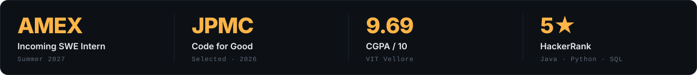

  

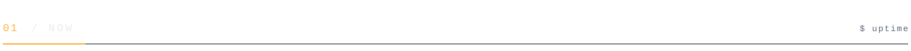

  

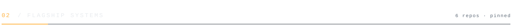

<table>
  <tr>
    <td width="50%"><a href="https://github.com/EklavyaGoyal17/AEGIS"></a></td>
    <td width="50%"><a href="https://github.com/EklavyaGoyal17/LedgerCore"></a></td>
  </tr>
  <tr>
    <td width="50%"><a href="https://github.com/EklavyaGoyal17/Forge"></a></td>
    <td width="50%"><a href="https://github.com/EklavyaGoyal17/haalchaal"></a></td>
  </tr>
  <tr>
    <td width="50%"><a href="https://github.com/EklavyaGoyal17/MeshSOS"></a></td>
    <td width="50%"><a href="https://github.com/EklavyaGoyal17/vapi-hustle"></a></td>
  </tr>
</table>

 

<b>&nbsp;Open the rest of the lab →</b>

 

| | Project | What it does | Stack |
|---|---|---|---|
| 🧭 | [**ATLAS**](https://github.com/EklavyaGoyal17/ATLAS) | Local engineering lab: synthetic payment flows, traced incident recipes, Java code intelligence, a cited evidence assistant | Java 21 · Spring · React · Postgres |
| 🩸 | [**LifeLine**](https://github.com/EklavyaGoyal17/DBMS-Project) | Blood bank system: donor eligibility → TTI screening → FEFO allocation → vein-to-vein audit trail | Oracle 21c · PL/SQL · Node.js |
| ⚖️ | [**Aequitas**](https://github.com/EklavyaGoyal17/aequitas) | Ledger benchmark comparing OCC, pessimistic, SSI and adaptive concurrency control under skewed load (paper) | Go · TLA+ · Python |
| 🌫️ | [**SmartCity IAQ Node**](https://github.com/EklavyaGoyal17/SmartCity-IAQ-Node) | Air quality from occupancy, with closed-loop ventilation (team lead, backend) | Arduino · Node.js · React |
| 🚀 | [**DevOps Pipeline**](https://github.com/EklavyaGoyal17/24BCE0743-DevOps-Project) | Commit → Maven → Docker → Kubernetes via Jenkins, monitored with Nagios | Spring Boot · Jenkins · K8s |
| 🖥️ | [**Lab-PC Fit Checker**](https://github.com/EklavyaGoyal17/Cisco-Lab-PC-Software-Fit-Checker) | Matches a project's software needs to lab PCs by OS, RAM and tool versions | Java · Swing |
| 🍱 | [**Campus Food Pre-Order**](https://github.com/EklavyaGoyal17/Microsoft-GitHub) | Pre-order and pickup with student riders, ratings and a loyalty discount | Python · Streamlit · SQLite |

 

   
  

 

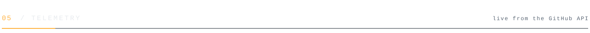

  

  

  

 

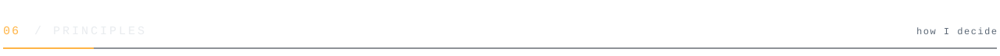
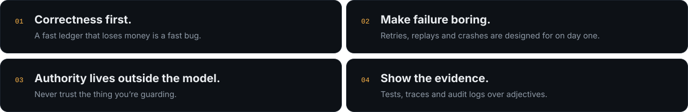

  

  

